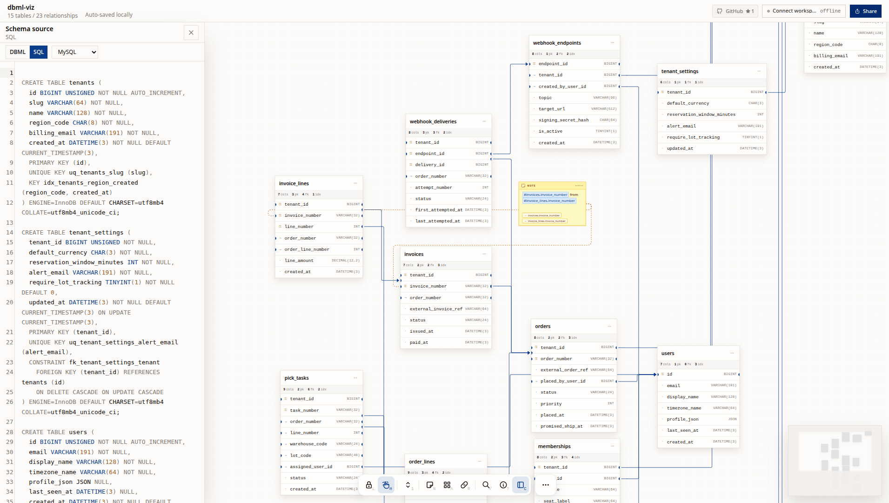

# dbml-viz

Interactive visualizer for DBML and SQL.

Try it at **[dbml-viz.com](https://dbml-viz.com)**



## Features

### Sticky Notes
- Add free-floating notes to the canvas

### Sharing & Persistence
- Share your design with a link

### Agent / MCP Workspace
- Connect an MCP client (Claude Code, Codex, Cursor, or any MCP-compatible agent) to the live canvas

and many more features and even more features to come.

## Stack

- React 19 + TypeScript
- Vite
- Cloudflare Workers and Durable Objects

## Development

```bash
bun install
bun dev
```
